<!-- _class: title-slide -->

# GDPR en AI act voor developers

## Software Trends: GDPR en AI Act

---

## Inhoud

- Wat is GDPR?
- Waar is GDPR van toepassing?
- Persoonlijke en sensitieve data
- Individuele GDPR-rechten
- Datalekken en boetes
- Software GDPR-proof maken: 15 tips
- GDPR bronnen
- De AI Act voor developers
- AI Act bronnen

---

<!-- _class: red-bg -->

# Wat is GDPR?

---

## Wat is GDPR?

**General Data Protection Regulation**


---

## Wat is GDPR?

- Europese wetgeving, van kracht sinds **25 mei 2018**
- Beschermt de burgers van de EU
- Zeker tegen Big Tech (Facebook, Google, Apple, ...)

---

## Waar is GDPR van toepassing?

Niet-Europese bedrijven die:

- goederen of diensten leveren in de EU
- Europese burgers volgen op Europees grondgebied

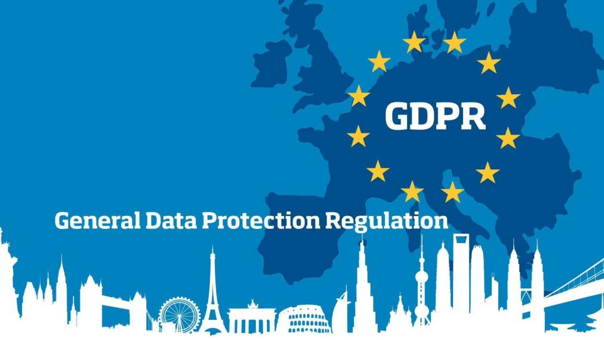

---

## Persoonlijke data

Alle gegevens die gelinkt kunnen worden aan een individu (of een kleine groep individuen).

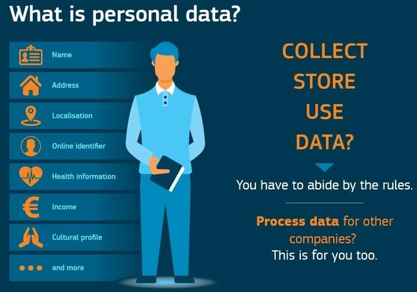

---

## Sensitieve data

Extra sensitieve categorieën:

- Etniciteit
- Politieke voorkeur
- Religie of filosofische overtuiging
- Vakbondslidmaatschap
- Genetische en biometrische data
- Gezondheidsdata
- Sexuele voorkeur

---

## Wanneer is GDPR niet van toepassing?

- Bedrijven met minder dan 250 werknemers: minder strikte regels
- Persoonlijk gebruik (bv. een Excel met adressen van vrienden en familie voor de kerstkaartjes)


## Individuele GDPR-rechten

- Recht op informatie
- Recht om vergeten te worden
- Recht op correctie
- Recht op verwijdering van data (niet absoluut)
- Recht op verminderde verwerking (niet absoluut)
- Recht op portabiliteit
- Recht op protest
- Recht op weigering van automated decision making

---

## Datalekken: de 72-uursregel

**Bij een datalek met persoonlijke data:**

- Melden bij de toezichthouder (in België: Gegevensbeschermingsautoriteit) **binnen 72 uur** na vaststelling (art. 33)
- Hoog risico voor betrokkenen? Dan de personen **onmiddellijk** informeren (art. 34)
- Elke inbreuk **documenteren** in een inbreukregister

> Encryptie loont dubbel: was de data versleuteld, dan kan de informatieverplichting richting betrokkenen komen te vervallen.

---

## Boetes

| Verordening | Maximumboete |
|---|---|
| **GDPR** | tot 20 miljoen euro of 4% van de wereldwijde jaaromzet |
| **AI Act: verboden praktijken** | tot 35 miljoen euro of 7% van de omzet |
| **AI Act: andere verplichtingen** | tot 15 miljoen euro of 3% |
| **AI Act: foutieve info** | tot 7,5 miljoen euro of 1% |

> Voor kmo's geldt proportionaliteit, maar het percentage van de omzet blijft pijnlijk.

---

<!-- _class: red-bg -->

# Software GDPR-proof maken

---

## 1. Heb ik de data echt nodig?

> De best beveiligde persoonlijke data is de niet-verkregen persoonlijke data.

---

## 2. Encrypteer alle persoonlijke data

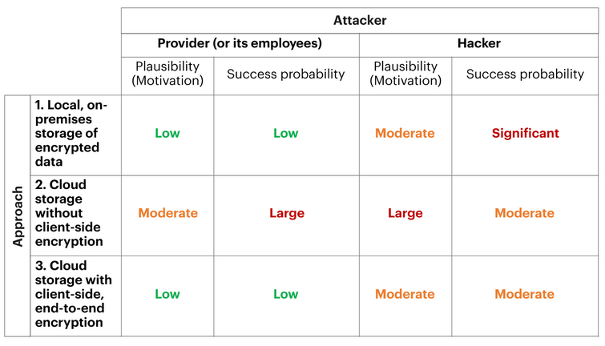

---

## 2. Encrypteer alle persoonlijke data

- Data breaches en hacks zijn onvermijdelijk
- Ashley Madison (2015): ongeëncrypteerde data van gebruikers open en bloot
- Meer dan 11 miljoen dollar aan lawsuits voor geschonden privacy

---

## 3. Gebruik https

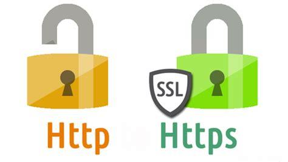

- Contact forms bevatten vaak gevoelige informatie
- HTTPS encrypteert deze data automatisch via TLS-protocollen

---

## 4. Consent moet open zijn

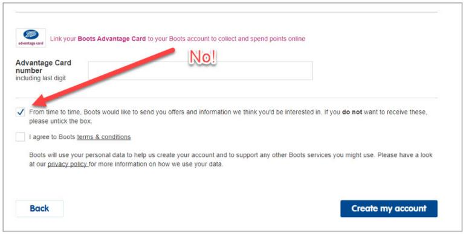

- Geen pre-ticked boxes!
- Opt-in in plaats van opt-out

---

## 5. Opt-in moet granulair zijn

- Verschillende opties
- Denk aan websites met functionele cookies en marketingcookies

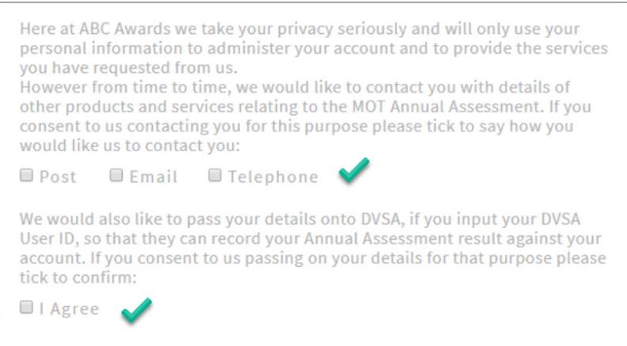

---

## 6. Wees specifiek over 3rd parties

Geef aan welke andere partijen de data zullen gebruiken.

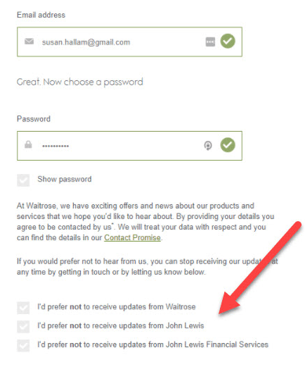

---

## 7. Terms & Conditions apart van andere goedkeuringen

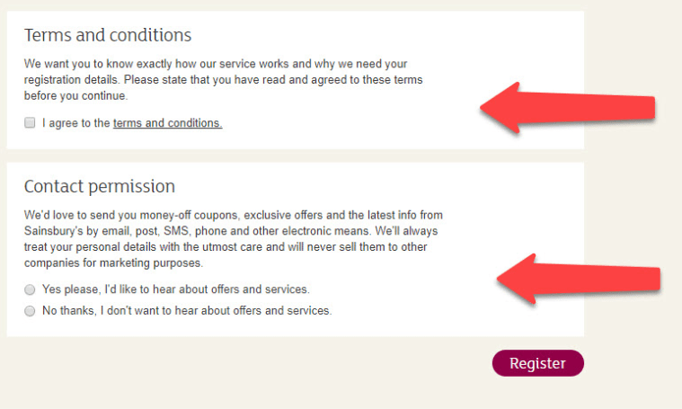

---

## 8. Terms & Conditions moet heel zichtbaar zijn

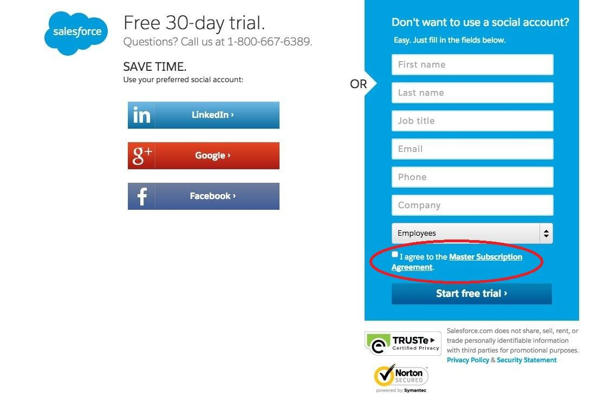

---

## 9. Gebruikers moeten consent kunnen intrekken

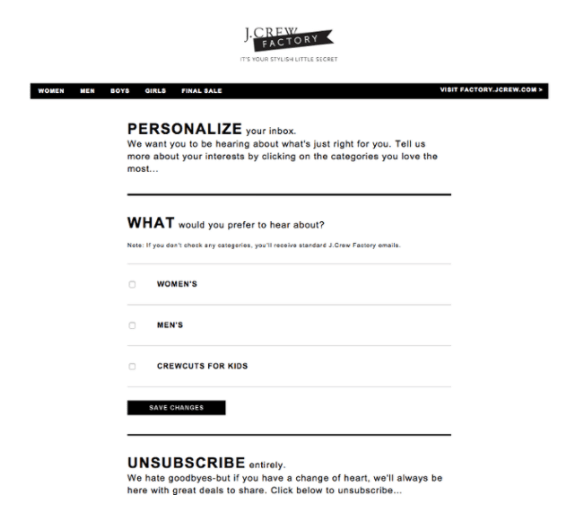

---

## 10. Pas het cookiebeleid aan

Cookies mogen enkel:

- Wettelijke verplichtingen (leeftijd op goksites)
- Legitiem belang, zolang ze geen individueel recht schaden (fraudepreventie)
- Noodzakelijke data (bankrekeningdata voor een aannemer)
- **User consent** - dit komt veruit het vaakst voor


---

## 11. Vermijd securityvragen met persoonlijke info

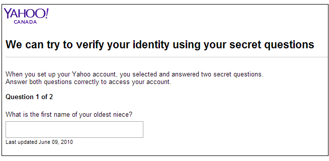

---

## 12. Informeer gebruikers over IP-logs

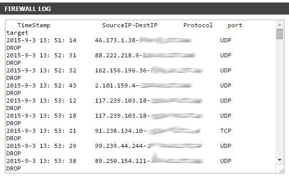

---

## 13. Verwijder persoonlijke data na de pay-gateway

- E-commerce: data verwijderen na 60 dagen
- Geen data bewaren via de pay-gateway


---

## 14. Users mogen business intelligence tracking weigeren

---

## 15. Verwijder ongevraagde tracking data

- Users mogen niet zonder toestemming worden geanalyseerd
- Gebeurde pre-GDPR vaak op e-commercewebsites

---

## GDPR bronnen

- [GDPR and privacy by design: what developers need to know](https://medium.com/sphere-identity/gdpr-and-privacy-by-design-what-developers-need-to-know-fa5a936da65a)
- [Data protection principles: 7 core principles of the GDPR](https://cloudian.com/guides/data-protection/data-protection-principles-7-core-principles-of-the-gdpr/)
- [gdpreu.org](https://www.gdpreu.org/)
- [How to make your software GDPR compliant](https://www.mindk.com/blog/how-to-make-your-software-gdpr-compliant/)

---

<!-- _class: red-bg -->

# De AI Act voor developers

---

### Labeling van AI-genereerde context

Dit onderdeel van de slides werd met hulp van AI gegenereerd. De inhoud werd zorgvuldig nagekeken.

---

## Wat is de AI Act?

- **Regulation (EU) 2024/1689**: eerste wereldwijde juridische kader voor AI
- Risk-based aanpak: verplichtingen afhankelijk van het risico van het AI-systeem
- Van toepassing op **providers** (bouwers) en **deployers** (gebruikers) van AI-systemen
- Ook voor niet-Europese bedrijven: als het systeem in de EU wordt gebruikt
- Boetes tot 35 miljoen euro of 7% van de wereldwijde omzet

---

## Vier risiconiveaus

| Risiconiveau | Regels | Voorbeelden |
|---|---|---|
| **Onaanvaardbaar** | verboden | social scoring, manipulatie, real-time biometrie door politie |
| **Hoog-risico** | strikte vereisten | CV-screening, credit scoring, medische diagnose |
| **Beperkt risico** | transparantie | chatbots, AI-gegenereerde content |
| **Minimaal risico** | geen | spamfilters, game-AI |

---

## Verboden AI-praktijken

Sinds februari 2025 verboden:

- Manipulatie en exploitatie van kwetsbare groepen
- Social scoring van mensen
- Emotionele herkenning op het werk en in het onderwijs
- Scrapen van gezichtsbeelden zonder toestemming
- Biometrische categorisatie van gevoelige kenmerken

---

## Hoog-risico systemen

AI is hoog-risico als veiligheid of fundamentele rechten op het spel staan:

- Werving en personeelsbeheer (CV-screening, ranking sollicitanten)
- Krediet- en verzekeringsbeslissingen
- Medische en kritieke infrastructuur
- Onderwijs (examenbeoordeling)
- Wetshandhaving en migratie

> Komt jouw feature hier in de buurt? Dan gelden de provider-verplichtingen.

---

## Provider-verplichtingen bij hoog-risico

| Verplichting | Wat betekent dit praktisch? |
|---|---|
| **Risicobeheersysteem** | continue risicoanalyse doorheen de levenscyclus |
| **Datakwaliteit en -governance** | training-, validatie- en testdata documenteren |
| **Technische documentatie** | logs, architectuur, doelen vastleggen |
| **Menselijk toezicht** | mens kan systeem ingrijpen of uitschakelen |
| **Nauwkeurigheid en robuustheid** | testen, bias-mitigatie |
| **CE-markering en registratie** | voor plaatsing op de markt |

---

## Transparantieverplichtingen (beperkt risico)

- Gebruiker moet weten dat er met AI communiceert (chatbots)
- AI-gegenereerde content labelen (deepfakes, AI-tekst, AI-beelden)
- Synthetische content moet detecteerbaar zijn

> Praktisch: "Deze chat is met een AI-assistent" en AI-output zichtbaar markeren
> Voorbeeld: deze slides!
---

## General purpose AI (GPAI)

Verplichtingen voor providers van foundation modellen (Claude, GPT, Gemma, ...):

- Technische documentatie en copyrightbeleid
- Trainingsdata samenvatten en publiceren
- Systeemrisico's beoordelen en melden

> Meestal niet jouw verantwoordelijkheid, maar kies GPAI-modellen die voldoen aan de AI Act

---

## Tijdlijn

| Datum | Wat wordt actief? |
|---|---|
| **feb 2025** | verboden praktijken, AI-literacy |
| **aug 2025** | verplichtingen GPAI, nationale marktoezicht |
| **aug 2026** | meeste regels, inclusief hoog-risico systemen |
| **aug 2027** | hoog-risico in gereguleerde producten |

---


<!-- _class: red-bg -->

# AI Act praktische richtlijnen

---

## Richtlijn 1: classificeer je AI-feature

Eerste vraag bij elke feature: **welk risiconiveau?**

| Feature-idee | Risiconiveau |
|---|---|
| Spamfilter in mailapp | minimaal |
| Chatbot op de website | beperkt |
| Automatische CV-screening in wervingsflow | hoog-risico |
| Risicoscore die mensen weigert | mogelijk onaanvaardbaar |

> Gebruik de [Compliance Checker](https://artificialintelligenceact.eu/assessment/) om dit te bepalen. Documenteer de classificatie: dat is meteen je eerste bewijsstuk voor een audit.

---

## Richtlijn 2: vermijd verboden praktijken

Sommige features bouw je gewoon **niet**:

- Emotieherkenning op het werk of in het onderwijs
- Social scoring (personen beoordelen op gedrag of kenmerken)
- Biometrische categorisatie van gevoelige kenmerken

**Voorbeeld uit de praktijk:**

```
❌ "We scoren kandidaten op basis van hun gezichtsuitdrukking tijdens het interview"
✅ "We ranken sollicitanten op hun antwoorden, met menselijke review"
```

> Als een feature alleen werkt door personen te beoordelen op hun persoon, bouw hem dan niet.

---

## Richtlijn 3: documenteer beslissingen en data

Wat je moet kunnen **aantonen** bij een audit:

| Documentatie | Praktisch voorbeeld |
|---|---|
| **Doel van het systeem** | "Prioriteert supporttickets, beslist niets automatisch" |
| **Trainings- en testdata** | herkomst, aantallen, filtering, bekende bias |
| **Modelversies** | welke versie draaide wanneer, met welke data |
| **Beslissingen en logs** | input, output, confidence, wie de override deed |

> Praktisch: logs en versies in je pipeline stoppen kost weinig werk tijdens het bouwen en is nagenoeg onmogelijk achteraf te reconstrueren.

---

## Richtlijn 4: human in the loop

Bij automatische beslissingen met impact: **menselijke override**.

```
❌ Model weigert kandidaat → afwijzingsmail verstuurt zichzelf
✅ Model flagt kandidaat → recruiter beoordeelt → mens beslist
```

- De mens moet kunnen **ingrijpen en uitschakelen**
- Beslissingen moeten **uitgelegd** kunnen worden
- GDPR art. 22: recht om niet aan uitsluitend geautomatiseerde besluitvorming onderworpen te zijn

> Voorbeeld: een bank wilde kredietbeslissingen volautomatiseren. Alleen met expliciete toestemming van de klant of met menselijke review.

---

## Richtlijn 5: label AI-gegenereerde content

Transparantieverplichting bij beperkt risico:

| Context | Wat moet erop? |
|---|---|
| Chatbot op website | "Deze chat gebruikt een AI-assistent" |
| AI-gegenereerde afbeelding | AI-label of watermerk |
| AI-samenvatting in product | "Automatisch gegenereerd, controleer de details" |

**Voorbeeld:** marketingfoto's van een evenement door AI gegenereerd? Zonder label misleiden ze de bezoeker; met label is het correct.

> Dit geldt ook voor content die jouw AI aanlevert aan klanten: voorzie de labels in de API-output.

---

## Richtlijn 6: test op bias en nauwkeurigheid

Vooral voor AI engineers:

- Test met **representatieve data**: alle groepen, ook de randgevallen
- Meet **false positives en false negatives** apart: een fout-positieve weigering treft een persoon
- Monitor in productie: drift, uitschieters, klachtenpatronen

**Voorbeeld:**

```
Een sollicitanten-ranking model scoort vrouwen systematisch lager
→ oorzaak: trainingsdata van een mannelijk gedomineerde functiegroep
→ oplossing: dataverdeling analyseren, bias-test in CI, menselijke review
```

---

## Richtlijn 7: combineer met GDPR

AI en GDPR lopen door elkaar:

- **Persoonlijke data in AI-output blijft persoonlijke data**: een gepseudonimiseerd profiel in een prompt is nog steeds GDPR-object
- **Doelbinding**: data verzameld voor dienst X mag niet zomaar als trainingsdata dienen
- **Datalek in trainingsdata of logs** = GDPR-datalek: 72-uursmeldplicht geldt
- **Recht op verwijdering**: hoe verwijder je iemand uit een getraind model? Retraining is duur: minimaliseer persoonlijke data in training

> Vuistregel: hoe minder persoonlijke data in je AI-pipeline, hoe minder beide regimes je pijn doen.

---

## Praktische checklist voor developers

- Classificeer je AI-feature: welk risiconiveau?
- Vermijd verboden praktijken (emotieherkenning, scoring)
- Documenteer beslissingen en data (ook voor audit)
- Zorg voor menselijke override bij automatische beslissingen (human in the loop)
- Label AI-gegenereerde content zichtbaar
- Test op bias en nauwkeurigheid (vooral voor AI engineers)
- Combineer met GDPR: persoonlijke data in AI-output blijft GDPR-object

---

## AI Act bronnen

- [artificialintelligenceact.eu](https://artificialintelligenceact.eu/)
- [AI Act: regelgevingskader (Europese Commissie)](https://digital-strategy.ec.europa.eu/en/policies/regulatory-framework-ai)
- [AI Act Explorer: volledige wettekst](https://artificialintelligenceact.eu/the-act/)
- [Compliance Checker](https://artificialintelligenceact.eu/assessment/)

---

## Vragen?

